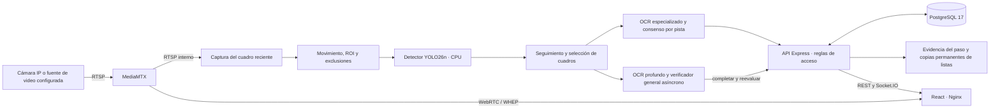

# Estado actual del sistema ANPR · ECU 911 Coordinación Zonal 3

**Actualizado:** 28 de octubre de 2026 · zona `America/Guayaquil`.

**Alcance:** código disponible, instalación local y evidencias de verificación; no certificación de producción pública ni evaluación definitiva de la tesis.

Este documento sustituye el estado del 14 de octubre. La comprobación del despliegue se conserva en [auditoría del sistema](docs/resultados/estado_sistema_auditoria_2026-10-28.json), con fecha, imágenes de contenedor, configuración no sensible y métricas del momento. El repositorio contiene cambios locales: el último commit, por sí solo, no identifica todo el código desplegado.

## 1. Situación operativa

La instalación local funciona con **cinco servicios**: frontend, backend, motor ANPR, PostgreSQL y MediaMTX. Los cuatro primeros tienen estado `healthy`; MediaMTX está en ejecución y no tiene healthcheck configurado. La API respondió HTTP 200 en `/health/ready`, la interfaz en `/healthz` y el motor indicó cámara conectada. Son comprobaciones de disponibilidad puntual.

La fuente activa es un **video de prueba en bucle** publicado mediante MediaMTX. Que el motor reciba RTSP no acredita todavía una prueba presencial con la cámara de la garita institucional.

Frontend y backend están compilados. El frontend se sirve con Nginx; el motor ejecuta Uvicorn sin `--reload`. No se monta su código fuente para recarga automática. La composición utilizada es `docker-compose.yml` más `docker-compose.produccion-local.yml`, proyecto `anpr`.

**Redis, Prometheus y Grafana no forman parte del despliegue activo.** Socket.IO opera sin Redis en esta instancia. Continúan las métricas del backend y motor y la visualización de recursos CPU en la aplicación, pero eso no equivale a tener ejecutándose la infraestructura antigua de observabilidad.

## 2. Función del sistema

Registra pasos vehiculares a partir de video, conserva la foto del vehículo y el recorte de la placa, interpreta el OCR y decide el acceso con las listas y sus restricciones. La lista negra produce alertas; la lista blanca exige coincidencia exacta, permiso vigente y las condiciones de lectura y horario configuradas. La revisión humana permite completar o corregir datos.

El registro del vehículo, el reconocimiento de su matrícula y la autorización son resultados distintos. Los pasos sin una lectura utilizable se conservan para revisión. Un rótulo reconocido como texto libre se guarda como observación y no se convierte en matrícula ni concede un permiso por sí mismo. Las lecturas alfanuméricas se deciden con la política configurada, que actualmente es **confianza** y no exige siempre `lectura_valida=true`.

## 3. Arquitectura vigente

Se conserva la separación de dominio, aplicación, infraestructura e interfaz en backend, frontend y motor. Los repositorios, la persistencia de imágenes y las comunicaciones se conectan mediante los contenedores de composición. Véase [arquitectura limpia](docs/ARQUITECTURA_LIMPIA.md); las descripciones históricas de servicios deben contrastarse con este estado y los Compose actuales.

## 4. Motor y modelos que realmente se utilizan

| Componente | Estado verificado |
|---|---|
| Procesamiento | CPU; sin inferencia CUDA. Equipo identificado en los experimentos: Intel Core i9-13900H, 20 procesadores lógicos disponibles. |
| Captura | MediaMTX/RTSP, cuadros recientes y descarte de cuadros para evitar una cola creciente; movimiento, ROI y exclusiones activados. |
| Detector | YOLO26n, `models/license_plate_detector.pt`, afinado en Open Images V7; backend YOLO/PyTorch CPU, con 4 hilos configurados en el servicio actual. |
| Identidad del detector | SHA-256 `3667d8168e8a5a62fddf0992546efa0dc60f37578c9e95e8c0cbc92d4ed74c5c`. |
| Umbrales | Configuración operativa de placa 0,22; el detector admite 0,06 para la asociación de pistas y el backend exige al menos 0,23 de confianza de detección para registrar. Son filtros distintos del umbral 0,35 de una evaluación histórica. |
| Seguimiento | Filtro de Kalman y asociación en dos fases, inspirada en ByteTrack; no se presenta como una reproducción íntegra de su implementación original. |
| OCR especializado | Biblioteca FastPlateOCR con `cct-s-v2-global-model`, ONNX y ejecución CPU; 2 hilos. `fastalpr` es el nombre heredado mostrado por el motor, no una segunda biblioteca comprobada en esta ruta. |
| OCR ecuatoriano afinado | El archivo promovido `models/ocr/cct_s_v2_ecuador.onnx` **no existe en el contenedor**; se utiliza el modelo global. Los candidatos de entrenamiento no equivalen a un modelo productivo validado. |
| Verificador | PP-OCRv6 `medium`, OpenVINO, 4 hilos; presupuesto configurado de 2.000 ms. |
| Registro inicial | `REGISTRO_MAX_MS=1000`: presupuesto de espera de una etapa, no garantía de persistencia o decisión completa en menos de un segundo. |
| Rectificación aprendida | El archivo `models/plate_rectifier.pt` no existe en el contenedor; no atribuir al despliegue el uso del candidato aprendido. |
| Atributos del vehículo | Configuración habilitada para YOLO y CLIP ViT-B-32. Son estimaciones auxiliares; no está demostrada su exactitud en una muestra independiente ecuatoriana. |

La ficha de modelos y sus experimentos están en [MODEL_CARD.md](services/anpr/models/MODEL_CARD.md). Las latencias históricas del detector exportado a OpenVINO no describen automáticamente este detector PyTorch ni el tiempo de un acceso completo.

## 5. Flujo del registro y mejora del OCR

**Política efectiva observada:** criterio `confianza` guardado en la base, mínimo OCR del 82 %, fuente `ocr` y verificación del vehículo habilitada. Los tres últimos valores proceden de las omisiones efectivas documentadas en la auditoría. La [regla de decisión](backend/src/dominio/decisionAcceso.ts) permite que un permiso vigente se autorice por confianza aunque el veredicto de validez no sea verdadero, si se satisfacen las demás condiciones. Por ello no corresponde afirmar que toda autorización automática exige lectura válida. La conservación de fotos permanentes en las listas aplica una condición más estricta y es un proceso distinto.

1. Se detecta y sigue el vehículo o la región candidata en los cuadros disponibles, respetando zonas y movimiento.
2. Se selecciona evidencia visual y se registra el paso; el OCR y los atributos pueden completar la ficha en fases posteriores.
3. Las lecturas de una misma pista aportan consenso. La interpretación del formato y las evidencias E1–E5 ayudan a aceptar o revisar la matrícula; su compatibilidad sintáctica no sustituye la lectura visual.
4. El backend cruza las listas, aplica las reglas de decisión y emite actualizaciones y notificaciones. La deduplicación busca que un mismo paso físico no genere varios registros, con una ventana configurada de 35 s.
5. La verificación tardía puede corregir una candidata automática. Se conservan las decisiones protegidas del personal y las alertas según las reglas del caso de uso.

La mejora incorporada en octubre separa la confianza visual del puntaje de formato: el ajuste a un patrón ya no eleva por sí solo la confianza del OCR. El verificador general conserva también texto abierto. Una compuerta heurística puede abstenerse de publicar una matrícula y guardar ese texto en `evidencia_lectura.observacion_ocr`.

En el caso de desarrollo del rótulo **HAVAL / ambacar**, el comportamiento esperado y comprobado es matrícula vacía y texto como observación, conservando las fotos y el paso. La compuerta usa un umbral de confianza de texto de 0,90, reglas de contenido y el resultado del lector general; no es una probabilidad calibrada de corrección ni una SelectiveNet entrenada. Tampoco usa una lista de marcas prohibidas.

La candidata descartada se retira del seguimiento visual y no debe seguir acumulando votos tardíos. Si el texto pertenece a otra pista del mismo vehículo que ya tiene matrícula, se añade al mismo acceso sin sustituir esa matrícula. El diagnóstico, las condiciones y el protocolo se detallan en [reconocimiento selectivo en CPU](docs/OCR_CPU_RECONOCIMIENTO_SELECTIVO.md).

## 6. Interfaz y módulos disponibles

| Área | Comportamiento actual |
|---|---|
| Control de garita | Registro de entrada y salida, movimientos recientes y revisión de accesos. El indicador **Registros de acceso** representa el total histórico de los registros incluidos por la consulta de detecciones, no sólo los autorizados sin salida. |
| Monitoreo | Video WebRTC, zonas y seguimiento; la API sincroniza las cámaras con MediaMTX y el motor. |
| Tabla de ingresos | Vista en cuadrícula, campos editables visibles, cédula como segunda columna, motivo, vehículo, marca y modelo. La placa y su evidencia están separadas de la columna **Confianza**. Acciones de edición y eliminación mediante iconos. |
| Validación de ingreso | Formulario panorámico, placa dentro de datos del vehículo, campos vehiculares obligatorios y fotos ampliables del vehículo y de la placa. Se admite **Jornada laboral** como motivo. Los horarios guardados como JSON se normalizan; un horario dañado requiere corrección explícita. |
| Gestión de permisos | Solicitudes y permisos del usuario, incluidos permisos por nombre con placa pendiente; el gestor conserva la propiedad de sus permisos. |
| Lista blanca y negra | Formularios coherentes y panorámicos, dos columnas de evidencia y zoom. Cada foto tiene estado y fecha propios. |
| Notificaciones | Persistencia en PostgreSQL, entrega por Socket.IO y funciones de reconocimiento, resolución y escalamiento. El canal Web Push depende de la configuración y permisos del navegador. No se declara certificación ISA-18.2/IEC 62682. |
| Administración | Cuentas y permisos, cámaras, configuración, auditoría, reportes y análisis de ingresos. |
| Estado del sistema | Disponibilidad y recursos; métricas CPU directas del entorno/VM de Docker Desktop, backend y motor. No es una medición del uso global de Windows. |
| Evaluación científica | El módulo web y sus endpoints de evaluación fueron retirados. Se conservan scripts y artefactos experimentales fuera de ese módulo. |

Los tres roles son **Guardia**, **GestorPermisos** y **Admin**. La autoridad vigente es la [matriz de permisos](backend/src/dominio/permisos.ts): Guardia también tiene permisos de gestión de padrón y alertas; el gestor resuelve solicitudes y administra sus permisos; Admin dispone de todos los permisos declarados. No debe mantenerse la descripción antigua de Guardia como lector exclusivo de las listas.

## 7. Consultas externas retiradas y evidencia permanente

Las consultas externas de vehículo por placa y de persona por cédula fueron retiradas por su consumo de créditos. Los formularios se completan manualmente. Las rutas antiguas de consulta y disponibilidad devuelven **HTTP 410**, sin cargar ni llamar a los proveedores. La búsqueda del padrón y del historial local continúa sin consumo de créditos. Véase [registro manual de vehículo](docs/CONSULTA_VEHICULO_API.md).

Las listas conservan su **primera foto disponible por columna** cuando la matrícula coincide exactamente con una entrada procesada y confirmada. Mientras `segundo_ocr_pendiente=true`, no se fija evidencia automáticamente; una lectura desconocida o rechazada tampoco la fija sin confirmación humana. La condición no garantiza dos lectores independientes para toda foto: una lectura confirmada por el motor sin ese indicador de espera también puede conservarse. Una coincidencia aproximada de lista negra no puede asociar la foto a otra matrícula.

Sin evidencia se muestra **Vehículo aún no ha ingresado** o **Placa aún no ingresada**. Al conservar la foto correspondiente, la celda cambia a verde, muestra **Vehículo ingresado** o **Placa ingresada** y la fecha de captura. Tener foto del auto no implica tener recorte de placa. El color identifica evidencia histórica; no reemplaza la vigencia del permiso ni la decisión de acceso.

Las copias se guardan en el volumen `anpr_listas_evidencia`, montado en `/app/evidencia-listas`, con propietario y usuario de escritura 1000. Son independientes de la carpeta del motor y sobreviven a la eliminación del acceso y sus archivos originales. Cambiar la matrícula del registro reinicia sus evidencias para no mostrar fotos de otro vehículo. En el despliegue verificado se recuperaron **seis fotos** del historial y se comprobó su entrega HTTP 200. Detalles en [evidencia de permisos y listas](docs/EVIDENCIA_PERMISOS_LISTAS.md).

## 8. Persistencia y seguridad implementada

La base activa es **PostgreSQL 17**. El esquema está en `db/postgresql/esquema.sql`; el backend aplica inicialización y migraciones idempotentes, incluidas las de campos del permiso y evidencia de listas. Los scripts antiguos de SQL Server permanecen como antecedentes y compatibilidad: no significan que SQL Server esté en ejecución.

Tablas centrales: `DeteccionVehiculo`, `VehiculosAutorizados`, `ListaNegra`, `SolicitudesAcceso`, `Camaras`, `Usuarios`, `Notificaciones` y auditorías. Se conservan lectura original, validaciones, observaciones OCR, datos de permiso y fechas de ingreso/salida. La ficha del ingreso y un permiso de lista blanca son entidades distintas.

La aplicación incorpora autenticación JWT, comprobación de cuenta vigente, RBAC, token del servicio ANPR, enlaces de imágenes firmados y cifrado de credenciales de cámaras. Las claves no se incluyen en este documento ni en los resultados públicos. Estas medidas no constituyen una auditoría integral de seguridad ni una certificación.

## 9. Servicios y exposición real de puertos

| Servicio | Contenedor | Publicación actual en el anfitrión |
|---|---|---|
| React servido por Nginx | `anpr-frontend` | `127.0.0.1:3000` → 8080 |
| API Express | `anpr-backend` | `0.0.0.0:5000`, también IPv6 |
| Motor FastAPI | `anpr-service` | `0.0.0.0:8000`, también IPv6 |
| PostgreSQL 17 | `anpr-db` | `127.0.0.1:5433` → 5432 |
| MediaMTX | `anpr-mediamtx` | WHEP 8889 y WebRTC 8189 TCP/UDP en todas las interfaces; RTSP `127.0.0.1:8554` |

Es una instalación local con código empaquetado en modo producción. El frontend está limitado a localhost, mientras API y motor mantienen publicaciones en todas las interfaces. No se ha acreditado en esta actualización una publicación en Internet, una prueba de carga prolongada ni el endurecimiento completo de un despliegue externo. No se cambiaron puertos durante esta revisión documental.

## 10. Métricas de operación observadas

La [instantánea del 28 de octubre, 15:03, hora de Ecuador](docs/resultados/estado_sistema_auditoria_2026-10-28.json) registra video H.264 de **1920 × 1080**, recepción cercana a 30 FPS y cámara conectada. El ritmo de captura no equivale al ritmo de inferencia: el seguimiento reportó 2,8 FPS en esa lectura puntual y existía descarte de cuadros.

| Métrica del acumulador del motor | Muestras | p50 | p95 | Máximo |
|---|---:|---:|---:|---:|
| Edad del cuadro | 300 | 13 ms | 36 ms | 100 ms |
| Lectura en vivo | 200 | 429 ms | 1.556 ms | 2.726 ms |
| Registro | 94 | 780 ms | 3.303 ms | 7.745 ms |

Los acumuladores corresponden a ventanas de tamaños distintos, con otros servicios activos. No son un ensayo controlado ni una medición independiente por vehículo; no se deben sumar sus percentiles ni atribuir causalmente sus máximos a un componente sin instrumentación adicional. La fila de registro demuestra que **no se cumple siempre un segundo** en esa ventana. Hace falta evaluar colas, carga y latencia de extremo a extremo en secuencias representativas.

## 11. Verificación disponible y alcance científico

| Evidencia | Resultado documentado | Alcance |
|---|---|---|
| [Listas, SQL, guardado y rutas retiradas](docs/resultados/evidencias_listas_2026-10-28.json) | Compilaciones aprobadas; 21 pruebas de evidencia/SQL, 67 de detecciones y 4 de rutas retiradas; consultas antiguas HTTP 410; copias independientes y fotos reales accesibles. | Son conjuntos focales, no el total de todas las pruebas del repositorio. |
| [Interfaz de listas y permisos](docs/resultados/evidencias_listas_ui_2026-10-28.json) | Tres vistas, zoom, estados independientes, verde, conservación al editar y cierre correcto del visor; sin errores de página ni consultas externas. | Navegador con respuestas e imágenes artificiales interceptadas; las fotos reales se verificaron por separado en la API. |
| [Reproducción WebRTC del paquete desplegado](docs/resultados/webrtc_postdespliegue_2026-10-28.json) | Tres ciclos de video 1920 × 1080; aperturas 201 y cierres 200, sin errores de página/consola/promesas en ese ensayo. | Prueba funcional acotada; no disponibilidad continua garantizada. |
| [Formulario de ingreso desplegado](docs/resultados/produccion_formulario_2026-10-28.json) | Horarios históricos y dañados tratados sin fallo de `.every`; edición de marca y modelo. | Prueba de regresión del formulario. |
| [Detector, evaluación histórica Open Images](docs/resultados/detector_yolo26n_vs_yolov8n_openimages.json) | En 2.048 imágenes/2.816 placas, a 512 px, confianza 0,35 e IoU 0,5: F1 0,8725 frente a 0,6113 de la línea base. | El modelo nuevo entrenó en Open Images y la línea base no. No demuestra superioridad de arquitectura ni desempeño local ecuatoriano. No se reejecutó para esta actualización. |
| [OCR selectivo, regresión de desarrollo](docs/resultados/ocr_selectivo_smoke_piloto_2026-10-27.json) | Con las mismas inferencias de agente y verificador, diez recortes positivos conocidos se conservan y el único rótulo pasa de matrícula falsa a abstención con observación. | Una matrícula presente en entrenamiento y un negativo. No es holdout, generalización ni tasa de falsas matrículas cero. |

La auditoría de datos detectó poca diversidad real: entrenamiento OCR con 6.000 entradas sintéticas y 1.560 repeticiones reales de 78 imágenes de una sola matrícula; las diez imágenes reales de validación muestran la misma identidad. Los nombres de archivo distintos no evitan esa fuga. Del benchmark antiguo de 99 filas, ninguna imagen existe hoy en las rutas esperadas; sus cifras no se presentan como una reevaluación actual.

La mejora demostrada hasta ahora es una corrección funcional y una regresión de desarrollo del rechazo de rótulos. El nuevo apartado [Antecedentes investigativos](ANTECEDENTES_INVESTIGATIVOS.md) la relaciona con la literatura; el [protocolo OCR en CPU](docs/OCR_CPU_RECONOCIMIENTO_SELECTIVO.md) define cómo evaluar su contribución sin atribuirle novedad mundial o superioridad no medida.

## 12. Pendientes para validación de tesis y operación sostenida

- Reunir entradas de vehículos distintos y negativos difíciles; separar entrenamiento, calibración y prueba por vehículo, clip y, cuando sea posible, cámara/jornada.
- Realizar la prueba de campo autorizada en la garita real. Una cámara conectada y los videos de desarrollo no acreditan ese ensayo institucional.
- Revisar y validar la política efectiva de autorización si el requisito institucional es exigir siempre un veredicto de lectura válido; no se cambió el criterio `confianza` durante esta actualización documental.
- Medir exactitud de matrícula completa, CER, falsas matrículas en negativos, riesgo/cobertura y latencias p50/p95 de extremo a extremo en CPU, con intervalos y unidades independientes.
- Ejecutar ablaciones que separen confianza visual, compuerta de texto y consenso. No atribuir al mecanismo nuevo las mejoras del verificador que ya existía.
- Calibrar umbrales en desarrollo y congelar la configuración antes de la prueba. Cualquier cuantización o modelo afinado requiere medición de exactitud y costo en el hardware objetivo antes de promoverse.
- Validar recuperación, respaldo conjunto de PostgreSQL y volumen de evidencias, concurrencia y estabilidad prolongada según el uso previsto.

Para reconstruir la versión local se utilizan los comandos de [estabilización del despliegue](docs/ESTABILIZACION_PRODUCCION_LOCAL.md). Las comprobaciones de esta actualización fueron de lectura y documentación: no se reiniciaron servicios ni se modificaron permisos, datos o modelos.
