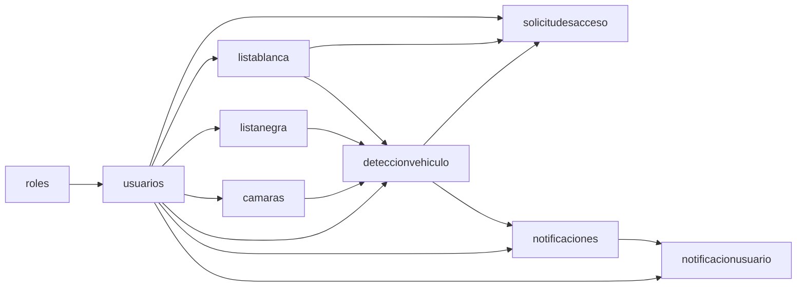

# Esquema completo actual de la base ANPR

**Fecha:** 29 de octubre de 2026. **Motor:** PostgreSQL 17. **Base:** `ANPR_ECU911`. **Esquema:** `public`.

La estructura fue consultada directamente en la base en ejecución. No contiene registros de personas, placas ni credenciales. La tabla de permisos es `listablanca`; existen **22 tablas**.

- [SQL completo exportado de la base, con índices, secuencias y restricciones](resultados/esquema_postgresql_completo_2026-10-29.sql).
- [Esquema mantenido por la aplicación](../db/postgresql/esquema.sql).
- [Procedimiento de renombre y verificación de integridad](RENOMBRE_LISTA_BLANCA.md).

`db/esquema_completo.sql` es un archivo histórico de SQL Server. La estructura PostgreSQL vigente está en los enlaces anteriores. El SQL exportado describe la estructura completa; las actualizaciones de una instalación existente se realizan con las migraciones de la aplicación.

## Tablas por función

| Función | Tablas |
|---|---|
| Operación y configuración | `listablanca`, `listanegra`, `deteccionvehiculo`, `solicitudesacceso`, `camaras`, `configuracionsistema` |
| Seguridad y sesiones | `roles`, `usuarios`, `verificacionemail`, `restablecimientopassword`, `suscripcionespush`, `clavesservicio` |
| Notificaciones | `notificaciones`, `notificacionusuario` |
| Auditoría | `auditoriaaccesos`, `auditoriaaccesosarchivo`, `auditoriausuarios`, `auditoriausuariosarchivo`, `auditoriaoperaciones`, `auditoriaoperacionesarchivo`, `auditoriadescartes`, `auditoriaconsultapropietario` |

## Relaciones principales

Las flechas van desde la tabla referenciada hacia la tabla que contiene su clave foránea. Se muestran las relaciones centrales; las restantes se detallan debajo de cada tabla.

La columna `vehiculo_autorizado_id` conserva su nombre y ahora referencia `listablanca.id`. En cambio, `listablanca.solicitud_id` es una columna entera sin clave foránea declarada: no se dibuja una relación física inversa. Las fotos se conservan como rutas y fechas en las listas; no se creó una tabla de fotografías.

## Detalle de las 22 tablas

Los nombres de campos y el orden corresponden a la base existente. Las instalaciones nuevas pueden tener un orden físico diferente sin cambiar su significado. `IDENTITY` indica generación automática del ID.

### `listablanca`

**26 columnas.**

| Campo | Tipo | Admite NULL | Clave | Valor predeterminado |
|---|---|---|---|---|
| `id` | `integer` | No | PK | IDENTITY |
| `placa` | `varchar(10)` | Sí | — | — |
| `propietario` | `varchar(150)` | No | — | — |
| `departamento` | `varchar(100)` | Sí | — | — |
| `tipo_vehiculo` | `varchar(50)` | Sí | — | — |
| `activo` | `boolean` | Sí | — | true |
| `fecha_registro` | `timestamp` | Sí | — | CURRENT_TIMESTAMP |
| `marca` | `varchar(50)` | Sí | — | — |
| `modelo` | `varchar(50)` | Sí | — | — |
| `color` | `varchar(30)` | Sí | — | — |
| `registrado_por` | `integer` | Sí | FK | — |
| `fecha_actualizacion` | `timestamp` | Sí | — | — |
| `fecha_vencimiento` | `date` | Sí | — | — |
| `observaciones` | `varchar(255)` | Sí | — | — |
| `categoria` | `varchar(20)` | No | — | 'FUNCIONARIO'::character varying |
| `fecha_inicio` | `date` | Sí | — | — |
| `horario` | `varchar(600)` | Sí | — | — |
| `solicitud_id` | `integer` | Sí | — | — |
| `cedula` | `varchar(10)` | Sí | — | — |
| `institucion` | `varchar(150)` | Sí | — | — |
| `cargo` | `varchar(150)` | Sí | — | — |
| `ruta_evidencia_vehiculo` | `varchar(500)` | Sí | — | — |
| `ruta_evidencia_placa` | `varchar(500)` | Sí | — | — |
| `fecha_evidencia_vehiculo` | `timestamp` | Sí | — | — |
| `fecha_evidencia_placa` | `timestamp` | Sí | — | — |
| `motivo_ingreso` | `varchar(300)` | Sí | — | — |

**Claves foráneas:**

- `FOREIGN KEY (registrado_por) REFERENCES usuarios(id)`.

**Unicidad y validaciones:**

- `CHECK (((categoria)::text = ANY ((ARRAY['EMERGENCIA'::character varying, 'OFICIAL'::character varying, 'CONTRATISTA'::character varying, 'PROVEEDOR'::character varying, 'VISITANTE'::character varying, 'FUNCIONARIO'::character varying])::text[])))`.
- `UNIQUE (placa)`.

### `listanegra`

**20 columnas.**

| Campo | Tipo | Admite NULL | Clave | Valor predeterminado |
|---|---|---|---|---|
| `id` | `integer` | No | PK | IDENTITY |
| `placa` | `varchar(10)` | Sí | — | — |
| `motivo` | `varchar(255)` | No | — | — |
| `nivel_alerta` | `varchar(20)` | Sí | — | 'ALTA'::character varying |
| `fecha_registro` | `timestamp` | Sí | — | CURRENT_TIMESTAMP |
| `activo` | `boolean` | Sí | — | true |
| `marca` | `varchar(50)` | Sí | — | — |
| `modelo` | `varchar(50)` | Sí | — | — |
| `color` | `varchar(30)` | Sí | — | — |
| `registrado_por` | `integer` | Sí | FK | — |
| `fecha_actualizacion` | `timestamp` | Sí | — | — |
| `fecha_vencimiento` | `date` | Sí | — | — |
| `observaciones` | `varchar(255)` | Sí | — | — |
| `tipo_vehiculo` | `varchar(50)` | Sí | — | — |
| `fecha_inicio` | `date` | Sí | — | — |
| `horario` | `varchar(600)` | Sí | — | — |
| `ruta_evidencia_vehiculo` | `varchar(500)` | Sí | — | — |
| `ruta_evidencia_placa` | `varchar(500)` | Sí | — | — |
| `fecha_evidencia_vehiculo` | `timestamp` | Sí | — | — |
| `fecha_evidencia_placa` | `timestamp` | Sí | — | — |

**Claves foráneas:**

- `FOREIGN KEY (registrado_por) REFERENCES usuarios(id)`.

**Unicidad y validaciones:**

- `CHECK (((nivel_alerta)::text = ANY ((ARRAY['MEDIA'::character varying, 'ALTA'::character varying, 'CRITICA'::character varying])::text[])))`.
- `UNIQUE (placa)`.

### `deteccionvehiculo`

**55 columnas.**

| Campo | Tipo | Admite NULL | Clave | Valor predeterminado |
|---|---|---|---|---|
| `id` | `integer` | No | PK | IDENTITY |
| `confianza_deteccion` | `double precision` | Sí | — | — |
| `confianza_ocr` | `double precision` | Sí | — | — |
| `tracking_id` | `integer` | Sí | — | '-1'::integer |
| `fuente` | `varchar(255)` | Sí | — | 'rtsp'::character varying |
| `tipo_movimiento` | `varchar(10)` | No | — | 'ingreso'::character varying |
| `estado_validacion` | `varchar(30)` | Sí | — | 'no_reconocido'::character varying |
| `camara_id` | `integer` | Sí | FK | — |
| `alerta_id` | `integer` | Sí | FK | — |
| `vehiculo_autorizado_id` | `integer` | Sí | FK | — |
| `estado_procesamiento` | `varchar(30)` | Sí | — | 'pendiente_ocr'::character varying |
| `ruta_imagen_ingreso` | `varchar(255)` | Sí | — | — |
| `ruta_imagen_placa` | `varchar(255)` | Sí | — | — |
| `fecha_hora_ingreso` | `timestamp` | Sí | — | CURRENT_TIMESTAMP |
| `placa_reconocida` | `varchar(20)` | Sí | — | — |
| `fecha_hora_procesamiento` | `timestamp` | Sí | — | — |
| `validado_manualmente` | `boolean` | Sí | — | false |
| `placa_validada` | `varchar(20)` | Sí | — | — |
| `usuario_validador_id` | `integer` | Sí | FK | — |
| `tipo_vehiculo` | `varchar(50)` | Sí | — | — |
| `placa_ocr_original` | `varchar(20)` | Sí | — | — |
| `confianza_ocr_original` | `double precision` | Sí | — | — |
| `decision_automatica` | `varchar(30)` | Sí | — | — |
| `lectura_verificador` | `varchar(20)` | Sí | — | — |
| `latencia_ms` | `integer` | Sí | — | — |
| `luminancia_media` | `double precision` | Sí | — | — |
| `distancia_estimada_m` | `double precision` | Sí | — | — |
| `ancho_placa_px` | `integer` | Sí | — | — |
| `nitidez` | `double precision` | Sí | — | — |
| `velocidad_px_s` | `double precision` | Sí | — | — |
| `modelo_detector` | `varchar(100)` | Sí | — | — |
| `modelo_ocr` | `varchar(100)` | Sí | — | — |
| `fecha_validacion` | `timestamp` | Sí | — | — |
| `vehiculo_tipo` | `varchar(50)` | Sí | — | — |
| `vehiculo_color` | `varchar(30)` | Sí | — | — |
| `vehiculo_marca` | `varchar(50)` | Sí | — | — |
| `vehiculo_modelo` | `varchar(50)` | Sí | — | — |
| `vehiculo_atributos_json` | `varchar(500)` | Sí | — | — |
| `verificacion_vehiculo` | `varchar(20)` | Sí | — | — |
| `verificacion_detalle` | `varchar(255)` | Sí | — | — |
| `lectura_valida` | `boolean` | Sí | — | — |
| `evidencia_lectura` | `varchar(1500)` | Sí | — | — |
| `restriccion_acceso` | `varchar(30)` | Sí | — | — |
| `persona_ingreso` | `varchar(150)` | Sí | — | — |
| `motivo_ingreso` | `varchar(300)` | Sí | — | — |
| `fecha_hora_salida` | `timestamp` | Sí | — | — |
| `cedula_ingreso` | `varchar(10)` | Sí | — | — |
| `institucion_ingreso` | `varchar(150)` | Sí | — | — |
| `cargo_ingreso` | `varchar(150)` | Sí | — | — |
| `departamento_ingreso` | `varchar(100)` | Sí | — | — |
| `categoria_permiso` | `varchar(20)` | Sí | — | — |
| `observaciones_permiso` | `varchar(255)` | Sí | — | — |
| `vigencia_desde` | `date` | Sí | — | — |
| `vigencia_hasta` | `date` | Sí | — | — |
| `horario_permiso` | `varchar(600)` | Sí | — | — |

**Claves foráneas:**

- `FOREIGN KEY (alerta_id) REFERENCES listanegra(id)`.
- `FOREIGN KEY (camara_id) REFERENCES camaras(id)`.
- `FOREIGN KEY (usuario_validador_id) REFERENCES usuarios(id)`.
- `FOREIGN KEY (vehiculo_autorizado_id) REFERENCES listablanca(id)`.

**Unicidad y validaciones:**

- `CHECK (((tipo_movimiento)::text = ANY ((ARRAY['ingreso'::character varying, 'salida'::character varying])::text[])))`.

### `solicitudesacceso`

**26 columnas.**

| Campo | Tipo | Admite NULL | Clave | Valor predeterminado |
|---|---|---|---|---|
| `id` | `integer` | No | PK | IDENTITY |
| `placa` | `varchar(10)` | No | — | — |
| `propietario` | `varchar(150)` | No | — | — |
| `departamento` | `varchar(100)` | Sí | — | — |
| `categoria` | `varchar(20)` | No | — | 'VISITANTE'::character varying |
| `motivo` | `varchar(300)` | No | — | — |
| `tipo_vehiculo` | `varchar(50)` | Sí | — | — |
| `marca` | `varchar(50)` | Sí | — | — |
| `modelo` | `varchar(50)` | Sí | — | — |
| `color` | `varchar(30)` | Sí | — | — |
| `fecha_inicio` | `date` | Sí | — | — |
| `fecha_fin` | `date` | Sí | — | — |
| `horario` | `varchar(600)` | Sí | — | — |
| `deteccion_id` | `integer` | Sí | FK | — |
| `estado` | `varchar(20)` | No | — | 'pendiente'::character varying |
| `solicitado_por` | `integer` | No | FK | — |
| `fecha_solicitud` | `timestamp` | No | — | CURRENT_TIMESTAMP |
| `resuelto_por` | `integer` | Sí | FK | — |
| `fecha_resolucion` | `timestamp` | Sí | — | — |
| `comentario_resolucion` | `varchar(300)` | Sí | — | — |
| `vehiculo_autorizado_id` | `integer` | Sí | FK | — |
| `version` | `integer` | No | — | 1 |
| `cedula` | `varchar(10)` | Sí | — | — |
| `institucion` | `varchar(150)` | Sí | — | — |
| `cargo` | `varchar(150)` | Sí | — | — |
| `observaciones` | `varchar(255)` | Sí | — | — |

**Claves foráneas:**

- `FOREIGN KEY (deteccion_id) REFERENCES deteccionvehiculo(id) ON DELETE SET NULL`.
- `FOREIGN KEY (resuelto_por) REFERENCES usuarios(id)`.
- `FOREIGN KEY (solicitado_por) REFERENCES usuarios(id)`.
- `FOREIGN KEY (vehiculo_autorizado_id) REFERENCES listablanca(id)`.

**Unicidad y validaciones:**

- `CHECK (((estado)::text = ANY ((ARRAY['cancelada'::character varying, 'rechazada'::character varying, 'aprobada'::character varying, 'pendiente'::character varying])::text[])))`.

### `camaras`

**17 columnas.**

| Campo | Tipo | Admite NULL | Clave | Valor predeterminado |
|---|---|---|---|---|
| `id` | `integer` | No | PK | IDENTITY |
| `nombre` | `varchar(100)` | No | — | — |
| `ip` | `varchar(45)` | No | — | — |
| `rtsp_url` | `varchar(512)` | No | — | — |
| `ubicacion` | `varchar(150)` | No | — | — |
| `activa` | `boolean` | Sí | — | true |
| `created_at` | `timestamp` | Sí | — | CURRENT_TIMESTAMP |
| `estado` | `varchar(20)` | Sí | — | 'ACTIVA'::character varying |
| `ultimo_ping` | `timestamp` | Sí | — | — |
| `tiempo_respuesta_ms` | `integer` | Sí | — | — |
| `mensaje_ping` | `varchar(255)` | Sí | — | — |
| `registrado_por` | `integer` | Sí | FK | — |
| `fecha_actualizacion` | `timestamp` | Sí | — | — |
| `direccion` | `varchar(10)` | No | — | 'ingreso'::character varying |
| `roi` | `varchar(1000)` | Sí | — | — |
| `rtsp_url_vista` | `varchar(512)` | Sí | — | — |
| `exclusiones` | `text` | Sí | — | — |

**Claves foráneas:**

- `FOREIGN KEY (registrado_por) REFERENCES usuarios(id)`.

**Unicidad y validaciones:**

- `CHECK (((direccion)::text = ANY ((ARRAY['ingreso'::character varying, 'salida'::character varying])::text[])))`.

### `usuarios`

**16 columnas.**

| Campo | Tipo | Admite NULL | Clave | Valor predeterminado |
|---|---|---|---|---|
| `id` | `integer` | No | PK | IDENTITY |
| `email` | `varchar(150)` | No | — | — |
| `nombre_completo` | `varchar(150)` | No | — | — |
| `cargo` | `varchar(100)` | Sí | — | — |
| `password_hash` | `varchar(100)` | No | — | — |
| `rol_id` | `integer` | No | FK | — |
| `estado` | `varchar(20)` | No | — | 'pendiente'::character varying |
| `email_verificado` | `boolean` | No | — | false |
| `bloqueado` | `boolean` | No | — | false |
| `bloqueado_hasta` | `timestamp` | Sí | — | — |
| `intentos_fallidos` | `integer` | No | — | 0 |
| `fecha_ultimo_acceso` | `timestamp` | Sí | — | — |
| `fecha_cambio_password` | `timestamp` | Sí | — | — |
| `creado_por` | `integer` | Sí | FK | — |
| `fecha_creacion` | `timestamp` | No | — | CURRENT_TIMESTAMP |
| `fecha_actualizacion` | `timestamp` | Sí | — | — |

**Claves foráneas:**

- `FOREIGN KEY (creado_por) REFERENCES usuarios(id)`.
- `FOREIGN KEY (rol_id) REFERENCES roles(id)`.

**Unicidad y validaciones:**

- `CHECK (((estado)::text = ANY ((ARRAY['inactivo'::character varying, 'activo'::character varying, 'pendiente'::character varying])::text[])))`.
- `UNIQUE (email)`.

### `roles`

**4 columnas.**

| Campo | Tipo | Admite NULL | Clave | Valor predeterminado |
|---|---|---|---|---|
| `id` | `integer` | No | PK | IDENTITY |
| `codigo` | `varchar(20)` | No | — | — |
| `nombre` | `varchar(50)` | No | — | — |
| `descripcion` | `varchar(255)` | Sí | — | — |

**Unicidad y validaciones:**

- `UNIQUE (codigo)`.

### `notificaciones`

**18 columnas.**

| Campo | Tipo | Admite NULL | Clave | Valor predeterminado |
|---|---|---|---|---|
| `id` | `bigint` | No | PK | IDENTITY |
| `tipo` | `varchar(40)` | No | — | — |
| `severidad` | `varchar(10)` | No | — | — |
| `titulo` | `varchar(150)` | No | — | — |
| `mensaje` | `varchar(500)` | No | — | — |
| `enlace` | `varchar(200)` | Sí | — | — |
| `datos` | `varchar(1000)` | Sí | — | — |
| `clave_dedup` | `varchar(120)` | Sí | — | — |
| `repeticiones` | `integer` | No | — | 1 |
| `requiere_ack` | `boolean` | No | — | false |
| `deteccion_id` | `integer` | Sí | FK | — |
| `fecha_creacion` | `timestamp` | No | — | CURRENT_TIMESTAMP |
| `fecha_ultima` | `timestamp` | No | — | CURRENT_TIMESTAMP |
| `atendida_por` | `integer` | Sí | FK | — |
| `fecha_atencion` | `timestamp` | Sí | — | — |
| `fecha_resolucion` | `timestamp` | Sí | — | — |
| `escalada` | `boolean` | No | — | false |
| `fecha_escalamiento` | `timestamp` | Sí | — | — |

**Claves foráneas:**

- `FOREIGN KEY (atendida_por) REFERENCES usuarios(id)`.
- `FOREIGN KEY (deteccion_id) REFERENCES deteccionvehiculo(id) ON DELETE SET NULL`.

**Unicidad y validaciones:**

- `CHECK (((severidad)::text = ANY ((ARRAY['baja'::character varying, 'media'::character varying, 'alta'::character varying, 'critica'::character varying])::text[])))`.

### `notificacionusuario`

**4 columnas.**

| Campo | Tipo | Admite NULL | Clave | Valor predeterminado |
|---|---|---|---|---|
| `notificacion_id` | `bigint` | No | PK, FK | — |
| `usuario_id` | `integer` | No | PK, FK | — |
| `fecha_lectura` | `timestamp` | Sí | — | — |
| `fecha_eliminacion` | `timestamp` | Sí | — | — |

**Claves foráneas:**

- `FOREIGN KEY (notificacion_id) REFERENCES notificaciones(id) ON DELETE CASCADE`.
- `FOREIGN KEY (usuario_id) REFERENCES usuarios(id) ON DELETE CASCADE`.

### `auditoriaaccesos`

**8 columnas.**

| Campo | Tipo | Admite NULL | Clave | Valor predeterminado |
|---|---|---|---|---|
| `id` | `bigint` | No | PK | IDENTITY |
| `fecha` | `timestamp` | No | — | CURRENT_TIMESTAMP |
| `email` | `varchar(150)` | No | — | — |
| `usuario_id` | `integer` | Sí | FK | — |
| `exito` | `boolean` | No | — | — |
| `motivo` | `varchar(50)` | Sí | — | — |
| `ip` | `varchar(45)` | Sí | — | — |
| `user_agent` | `varchar(255)` | Sí | — | — |

**Claves foráneas:**

- `FOREIGN KEY (usuario_id) REFERENCES usuarios(id)`.

### `auditoriaaccesosarchivo`

**9 columnas.**

| Campo | Tipo | Admite NULL | Clave | Valor predeterminado |
|---|---|---|---|---|
| `id` | `bigint` | No | PK | — |
| `fecha` | `timestamp` | No | — | CURRENT_TIMESTAMP |
| `email` | `varchar(150)` | No | — | — |
| `usuario_id` | `integer` | Sí | FK | — |
| `exito` | `boolean` | No | — | — |
| `motivo` | `varchar(50)` | Sí | — | — |
| `ip` | `varchar(45)` | Sí | — | — |
| `user_agent` | `varchar(255)` | Sí | — | — |
| `fecha_archivado` | `timestamp` | No | — | CURRENT_TIMESTAMP |

**Claves foráneas:**

- `FOREIGN KEY (usuario_id) REFERENCES usuarios(id)`.

### `auditoriaconsultapropietario`

**9 columnas.**

| Campo | Tipo | Admite NULL | Clave | Valor predeterminado |
|---|---|---|---|---|
| `id` | `integer` | No | PK | IDENTITY |
| `usuario_id` | `integer` | No | FK | — |
| `usuario_nombre` | `varchar(100)` | Sí | — | — |
| `placa` | `varchar(20)` | No | — | — |
| `motivo` | `varchar(255)` | No | — | — |
| `deteccion_id` | `integer` | Sí | — | — |
| `proveedor` | `varchar(50)` | No | — | — |
| `resultado` | `varchar(20)` | No | — | — |
| `fecha` | `timestamp` | Sí | — | CURRENT_TIMESTAMP |

**Claves foráneas:**

- `FOREIGN KEY (usuario_id) REFERENCES usuarios(id)`.

### `auditoriadescartes`

**8 columnas.**

| Campo | Tipo | Admite NULL | Clave | Valor predeterminado |
|---|---|---|---|---|
| `id` | `integer` | No | PK | IDENTITY |
| `tracking_id` | `integer` | Sí | — | — |
| `motivo` | `varchar(100)` | No | — | — |
| `texto_candidato` | `varchar(50)` | Sí | — | — |
| `confianza` | `double precision` | Sí | — | — |
| `fuente` | `varchar(255)` | Sí | — | — |
| `camara_id` | `integer` | Sí | — | — |
| `fecha_registro` | `timestamp` | Sí | — | CURRENT_TIMESTAMP |

### `auditoriaoperaciones`

**9 columnas.**

| Campo | Tipo | Admite NULL | Clave | Valor predeterminado |
|---|---|---|---|---|
| `id` | `bigint` | No | PK | IDENTITY |
| `fecha` | `timestamp` | No | — | CURRENT_TIMESTAMP |
| `usuario_id` | `integer` | Sí | FK | — |
| `usuario_email` | `varchar(150)` | Sí | — | — |
| `accion` | `varchar(50)` | No | — | — |
| `entidad` | `varchar(40)` | No | — | — |
| `entidad_id` | `integer` | Sí | — | — |
| `detalle` | `varchar(500)` | Sí | — | — |
| `ip` | `varchar(45)` | Sí | — | — |

**Claves foráneas:**

- `FOREIGN KEY (usuario_id) REFERENCES usuarios(id)`.

### `auditoriaoperacionesarchivo`

**10 columnas.**

| Campo | Tipo | Admite NULL | Clave | Valor predeterminado |
|---|---|---|---|---|
| `id` | `bigint` | No | PK | — |
| `fecha` | `timestamp` | No | — | CURRENT_TIMESTAMP |
| `usuario_id` | `integer` | Sí | FK | — |
| `usuario_email` | `varchar(150)` | Sí | — | — |
| `accion` | `varchar(50)` | No | — | — |
| `entidad` | `varchar(40)` | No | — | — |
| `entidad_id` | `integer` | Sí | — | — |
| `detalle` | `varchar(500)` | Sí | — | — |
| `ip` | `varchar(45)` | Sí | — | — |
| `fecha_archivado` | `timestamp` | No | — | CURRENT_TIMESTAMP |

**Claves foráneas:**

- `FOREIGN KEY (usuario_id) REFERENCES usuarios(id)`.

### `auditoriausuarios`

**9 columnas.**

| Campo | Tipo | Admite NULL | Clave | Valor predeterminado |
|---|---|---|---|---|
| `id` | `bigint` | No | PK | IDENTITY |
| `fecha` | `timestamp` | No | — | CURRENT_TIMESTAMP |
| `accion` | `varchar(50)` | No | — | — |
| `actor_id` | `integer` | Sí | FK | — |
| `actor_email` | `varchar(150)` | Sí | — | — |
| `objetivo_id` | `integer` | Sí | — | — |
| `objetivo_email` | `varchar(150)` | Sí | — | — |
| `detalle` | `varchar(500)` | Sí | — | — |
| `ip` | `varchar(45)` | Sí | — | — |

**Claves foráneas:**

- `FOREIGN KEY (actor_id) REFERENCES usuarios(id)`.

### `auditoriausuariosarchivo`

**10 columnas.**

| Campo | Tipo | Admite NULL | Clave | Valor predeterminado |
|---|---|---|---|---|
| `id` | `bigint` | No | PK | — |
| `fecha` | `timestamp` | No | — | CURRENT_TIMESTAMP |
| `accion` | `varchar(50)` | No | — | — |
| `actor_id` | `integer` | Sí | FK | — |
| `actor_email` | `varchar(150)` | Sí | — | — |
| `objetivo_id` | `integer` | Sí | — | — |
| `objetivo_email` | `varchar(150)` | Sí | — | — |
| `detalle` | `varchar(500)` | Sí | — | — |
| `ip` | `varchar(45)` | Sí | — | — |
| `fecha_archivado` | `timestamp` | No | — | CURRENT_TIMESTAMP |

**Claves foráneas:**

- `FOREIGN KEY (actor_id) REFERENCES usuarios(id)`.

### `clavesservicio`

**3 columnas.**

| Campo | Tipo | Admite NULL | Clave | Valor predeterminado |
|---|---|---|---|---|
| `clave` | `varchar(60)` | No | PK | — |
| `valor` | `varchar(1000)` | No | — | — |
| `fecha_creacion` | `timestamp` | No | — | CURRENT_TIMESTAMP |

### `configuracionsistema`

**4 columnas.**

| Campo | Tipo | Admite NULL | Clave | Valor predeterminado |
|---|---|---|---|---|
| `clave` | `varchar(60)` | No | PK | — |
| `valor` | `varchar(500)` | No | — | — |
| `actualizado_por` | `integer` | Sí | FK | — |
| `fecha_actualizacion` | `timestamp` | No | — | CURRENT_TIMESTAMP |

**Claves foráneas:**

- `FOREIGN KEY (actualizado_por) REFERENCES usuarios(id)`.

### `restablecimientopassword`

**7 columnas.**

| Campo | Tipo | Admite NULL | Clave | Valor predeterminado |
|---|---|---|---|---|
| `id` | `integer` | No | PK | IDENTITY |
| `usuario_id` | `integer` | No | FK | — |
| `token_hash` | `char(64)` | No | — | — |
| `fecha_creacion` | `timestamp` | No | — | CURRENT_TIMESTAMP |
| `fecha_expiracion` | `timestamp` | No | — | — |
| `usado` | `boolean` | No | — | false |
| `fecha_uso` | `timestamp` | Sí | — | — |

**Claves foráneas:**

- `FOREIGN KEY (usuario_id) REFERENCES usuarios(id) ON DELETE CASCADE`.

### `suscripcionespush`

**10 columnas.**

| Campo | Tipo | Admite NULL | Clave | Valor predeterminado |
|---|---|---|---|---|
| `id` | `integer` | No | PK | IDENTITY |
| `usuario_id` | `integer` | No | FK | — |
| `endpoint` | `varchar(600)` | No | — | — |
| `endpoint_hash` | `char(64)` | No | — | — |
| `p256dh` | `varchar(200)` | No | — | — |
| `auth` | `varchar(100)` | No | — | — |
| `user_agent` | `varchar(255)` | Sí | — | — |
| `fecha_creacion` | `timestamp` | No | — | CURRENT_TIMESTAMP |
| `fecha_ultimo_uso` | `timestamp` | Sí | — | — |
| `fallos` | `integer` | No | — | 0 |

**Claves foráneas:**

- `FOREIGN KEY (usuario_id) REFERENCES usuarios(id) ON DELETE CASCADE`.

**Unicidad y validaciones:**

- `UNIQUE (endpoint_hash)`.

### `verificacionemail`

**7 columnas.**

| Campo | Tipo | Admite NULL | Clave | Valor predeterminado |
|---|---|---|---|---|
| `id` | `integer` | No | PK | IDENTITY |
| `usuario_id` | `integer` | No | FK | — |
| `token_hash` | `char(64)` | No | — | — |
| `fecha_creacion` | `timestamp` | No | — | CURRENT_TIMESTAMP |
| `fecha_expiracion` | `timestamp` | No | — | — |
| `usado` | `boolean` | No | — | false |
| `fecha_uso` | `timestamp` | Sí | — | — |

**Claves foráneas:**

- `FOREIGN KEY (usuario_id) REFERENCES usuarios(id) ON DELETE CASCADE`.

## Nombres históricos conservados

La tabla `vehiculosautorizados` ya no existe. Algunos nombres de índices, restricciones y de la secuencia de identidad contienen todavía ese identificador, por ejemplo `vehiculosautorizados_id_seq`. Siguen perteneciendo a `listablanca`; se conservaron para cumplir el alcance de renombrar únicamente la tabla, sin duplicar ni sustituir sus dependencias.

La estructura y las referencias fueron leídas sin modificar tablas ni datos.
