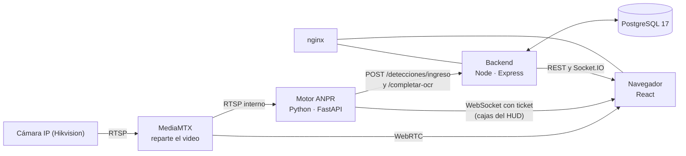

# Guía del sistema ANPR y cómo mejorarlo para el ECU 911

**Fecha:** 2 de noviembre de 2026.

**Para qué sirve:** entender cómo funciona cada parte (motor, OCR, backend y frontend), qué se probó, qué se corrigió y qué falta para operar en el ECU 911.

**Evidencia:** las cifras de carga salen de `docs/resultados/pruebas_carga_2026-11-02/` y se pueden repetir con `backend/scripts/carga/` (sección 9). Las cifras del motor salen de `docs/resultados/`.

---

## 1. El sistema en una página

El sistema lee las placas de los vehículos que pasan frente a una cámara, guarda la evidencia, decide el acceso con listas de control y avisa al personal en tiempo real.



| Parte | Tecnología | Qué hace | Dónde está |
|---|---|---|---|
| MediaMTX | Servidor de medios | Mantiene una sola conexión con cada flujo de la cámara y la reparte | `mediamtx/mediamtx.yml` |
| Motor ANPR | Python 3.12, FastAPI, YOLO26n, OCR | Detecta, sigue y lee placas | `services/anpr/app/` |
| Backend | Node 24, Express, TypeScript | Reglas de acceso, usuarios, auditoría, reportes | `backend/src/` |
| Base de datos | PostgreSQL 17 | Pasos, listas, usuarios, auditoría | `db/postgresql/` |
| Frontend | React 18, Vite 8 | Pantallas del personal | `frontend/src/` |

**Una regla que explica casi todo el diseño:** dejar pasar a quien no debe es mucho peor que molestar a un vehículo legítimo. Por eso una autorización automática exige mucha evidencia, y ante la duda decide una persona (`backend/src/dominio/decisionAcceso.ts`).

---

## 2. El recorrido de un vehículo

1. **La cámara envía video** a MediaMTX. El motor lo lee por RTSP interno y el navegador por WebRTC, sin una segunda conexión a la cámara.
2. **La compuerta de movimiento decide si vale la pena analizar.** Si la escena no cambió, se reutiliza la última detección.
3. **YOLO26n busca placas** dentro de la zona de interés.
4. **El seguidor mantiene la identidad** de cada placa entre cuadros, y el flujo óptico mueve la caja del HUD en los cuadros que el detector no analiza.
5. **El OCR rápido lee cada pista** en segundo plano y acumula lecturas.
6. **El selector elige el mejor cuadro** por nitidez, tamaño y distancia, y dispara la captura.
7. **Fase 1:** el motor guarda la foto y registra el paso en el backend (`POST /detecciones/ingreso`). El operador ya ve algo.
8. **Fase 2:** el verificador PP-OCRv6 relee la foto, se evalúa la validez de la lectura y se envía el resultado (`POST /detecciones/completar-ocr`).
9. **El backend decide** con la lista negra, la lista blanca y la confianza de la lectura.
10. **El backend difunde el resultado** por Socket.IO, crea las notificaciones y lo deja en la auditoría.

Registrar en dos fases permite que el paso exista aunque el OCR profundo tarde o falle.

**Medición de referencia** (video real de garita, 28-10-2026): registro p50 de 0,49 s y p95 de 1,58 s.

---

## 3. El motor ANPR

El núcleo es `services/anpr/app/aplicacion/motor.py`. No conoce FastAPI ni crea modelos: todo le llega por `DependenciasMotor` desde `app/main.py`. Por eso se puede probar sin cámara ni modelos (`tests/test_motor_contrato.py`).

### 3.1 Hilos

| Hilo o grupo | Trabajo | Por qué está separado |
|---|---|---|
| Captura | Lee cuadros de la fuente a su ritmo | Si se atrasa, se acumula video viejo |
| Detección | YOLO, seguimiento y selección | Es lo más caro; toma siempre el cuadro más reciente |
| `AsyncOCR` (2) | OCR rápido por pista | No debe frenar la detección |
| `Registro` (3) | Verificador, atributos y envío | Una lectura profunda no bloquea la siguiente |
| `DiskIO` (2) | Guardar fotos | El disco no debe frenar el video |
| `Reevaluacion` (2) | Corregir un registro si una pista posterior lee mejor | Evita duplicados con lecturas distintas |

### 3.2 Etapas

| Etapa | Archivo | Idea |
|---|---|---|
| Compuerta de movimiento | `aplicacion/movimiento.py` | No ejecuta YOLO si nada cambió; hace una inferencia de control cada 5 cuadros |
| Detector de placas | `infraestructura/detectors.py` | `license_plate_detector.pt` (YOLO26n) a 512 px, umbral 0,22 |
| Seguimiento | `aplicacion/detector.py` | ByteTrack con filtro de Kalman |
| Seguidor del HUD | `aplicacion/seguidor_flujo.py` | Lucas-Kanade: IoU de la caja de 0,21 a 0,76 (A/B del 21-10) |
| Selector de cuadro | `aplicacion/frame_selector.py` | Nitidez adaptada a la distancia; con respaldo por tiempo |
| Verificación geométrica | `aplicacion/verificacion_placa.py` | ¿Hay de verdad una fila de caracteres? ¿La placa está completa? |
| Consolidación | `aplicacion/consolidacion.py` | Un vehículo, un paso: une pistas que el seguimiento partió |
| Paso sin placa | `aplicacion/paso_sin_placa.py` | Registra autos y motos sin placa visible |
| Atributos del vehículo | `infraestructura/vehicle_attributes.py` | YOLO COCO + CLIP: tipo, color y marca, para detectar placas clonadas |

### 3.3 Calidad medida del detector

Con el notebook `services/anpr/notebooks/evaluar_detector_placas.ipynb` sobre Open Images (2 048 imágenes, 2 816 placas):

| Umbral | Precisión | Recall | F1 |
|---|---:|---:|---:|
| 0,22 (servicio) | 87,4 % | 83,8 % | 85,5 % |
| 0,35 | 93,8 % | 81,5 % | 87,3 % |

El umbral de servicio es bajo a propósito: prefiere encontrar la placa, y las etapas siguientes filtran los falsos positivos.

### 3.4 Resultado de punta a punta

Medido con el video de la garita el 28-10-2026, un solo sitio y de día:

- **Lectura exacta:** 87 de 96 (90,6 %, IC 83–95 %).
- **Lecturas erróneas dadas por confirmadas:** 0 de 77 (IC ≤ 4,8 %).

Estas cifras no dicen nada todavía de noche, lluvia, otras cámaras ni otros sitios (sección 8, punto 5).

### 3.5 Costo por cámara

Por cámara 1080p a 30 fps, en un i9-13900H sin GPU:

| Situación | CPU |
|---|---:|
| Garita vacía | 1,8–2,8 núcleos |
| Vehículo pasando | ~3,2 núcleos |

Tiempos por placa: OCR rápido 46 ms, verificador PP-OCRv6 159 ms, detector ~50 ms por cuadro.

> **El límite más importante del sistema:** un motor analiza **hasta 4 cámaras a la vez** en este equipo (`ANPR_MAX_CAMARAS`). Con 4 leyó 40/40 y 36/40 usando ~6 núcleos y ~3,3 GB. Con 6 cayó a 14/60. Las cámaras que no caben se pueden ver, pero quedan a la espera de análisis y Monitoreo lo avisa. Datos: `docs/resultados/multicamara_2026-11-02/`.

---

## 4. El OCR

### 4.1 Dos lectores

| Lector | Modelo | Cuándo corre | Ventaja |
|---|---|---|---|
| Rápido | `fast-plate-ocr` (`cct-s-v2-global`) | Varias veces por pista | Veloz; da muchas lecturas para votar |
| Verificador | PP-OCRv6 medium (RapidOCR + OpenVINO) | Una vez por vehículo, sobre la mejor foto | Más preciso, y con errores distintos a los del otro |

Si tarda más de `OCR_VERIFIER_MAX_MS` (2 s), se descarta el voto y se registra igual. Su voto pesa el doble (`OCR_VERIFIER_VOTE_WEIGHT`).

### 4.2 Interpretar sin inventar

El OCR da texto y una placa tiene formatos fijos. Una confusión típica (0↔O, 8↔B, 5↔S) puede explicar la diferencia, pero **cambiar un carácter es una hipótesis, no una lectura** (`dominio/interpretacion_placa.py`):

1. Elige el formato que encaja con menos sustituciones.
2. Nunca agrega, quita ni reordena caracteres.
3. Registra cada sustitución. Una placa con caracteres inferidos no se confirma sola.

Los formatos de la ANT y los tipos de servicio están en `dominio/ecuador_plate_validator.py` y `dominio/plate_parser.py`.

### 4.3 Las cinco evidencias (E1–E5)

Una lectura es **válida**, y el sistema puede decidir sin una persona, solo si cumple todas (`evaluar_lectura` en `verificacion_placa.py`):

| # | Evidencia | Qué evita |
|---|---|---|
| E1 | Formato oficial de la ANT | Textos que no son placas |
| E2 | Placa completa dentro del cuadro | Lecturas truncadas |
| E3 | Fila de caracteres plausible | Falsos positivos del detector |
| E4 | Misma placa en ≥ 2 cuadros, o igual al verificador | Una lectura suelta |
| E5 | Cada carácter leído tal cual por algún lector | Placas "corregidas" solo por el formato |

---

## 5. El backend

### 5.1 Capas

La regla es que las dependencias apuntan hacia adentro, y `src/tests/arquitectura.test.ts` la vigila.

| Capa | Carpeta | Contiene | Ejemplo |
|---|---|---|---|
| Dominio | `dominio/` | Reglas puras, sin HTTP ni SQL | `decisionAcceso.ts` |
| Aplicación | `aplicacion/` | Casos de uso; define "puertos" | `detecciones.ts` |
| Infraestructura | `infraestructura/` | SQL, correo, Socket.IO, archivos | `persistencia/deteccionesSql.ts` |
| Interfaz | `interfaz/http/` | Rutas y middlewares | `rutas/detecciones.ts` |
| Contenedor | `contenedor/` | Conecta todo lo anterior | `contenedor/panel.ts` |

### 5.2 La decisión de acceso

Tabla de `dominio/decisionAcceso.ts`; decide la primera regla que aplica:

| Regla | Condición | Resultado |
|---|---|---|
| R1 | Coincide con la lista negra (exacta o aproximada) | `alerta` |
| R2 | Hay permiso, pero no vigente (horario, inicio, vencido) | `no_reconocido` con restricción |
| R3 | Permiso vigente, decisión automática, la lectura no cumple el criterio | `pendiente_revision` |
| R4 | Permiso vigente, automática, el vehículo no coincide con el registrado | `pendiente_revision` |
| R5 | Permiso vigente | `autorizado` |
| R6 | Sin permiso, automática, lectura inválida | `pendiente_revision` |
| R7 | Sin permiso | `no_reconocido` |

Fíjate en la asimetría: la lista negra se cruza con tolerancia a errores del OCR, y la lista blanca exige coincidencia exacta.

### 5.3 Seguridad ya implementada

| Área | Cómo |
|---|---|
| Contraseñas | bcrypt de 12 rondas; bloqueo tras intentos fallidos; respuesta igual si la cuenta no existe |
| Sesión | JWT, y el estado de la cuenta se revisa con caché de 20 s: un bloqueo surte efecto rápido |
| Permisos | Matriz en `dominio/permisos.ts` |
| Motor ↔ backend | Token de servicio comparado en tiempo constante |
| Video | Tickets de 60 s; MediaMTX pregunta al backend en cada lectura |
| Fotos | Enlaces firmados con vencimiento |
| Credenciales | AES-256-GCM para las claves de cámaras y SMTP |
| SSRF | Lista de redes permitidas para cámaras |
| Abuso | Límite por IP: 600/min general, 20 intentos de acceso cada 15 min |
| Trazabilidad | Auditoría con retención y archivado |

### 5.4 Tiempo real y datos

- **Socket.IO** difunde `deteccion:nueva` y otros eventos a cada sesión. Sin Redis funciona en una sola instancia; con el adaptador de Redis (`infraestructura/servicios/socket.ts`) admite varias.
- **PostgreSQL:** la tabla central es `deteccionvehiculo`. El esquema se aplica al arrancar (`infraestructura/db.ts`) y las migraciones son idempotentes.

---

## 6. El frontend

| Capa | Carpeta | Contiene |
|---|---|---|
| Dominio | `src/dominio/` | Tipos, formatos, validaciones |
| Aplicación | `src/aplicacion/` | Sesión, tiempo real, hooks (`useConsulta`, `useEvento`) |
| Infraestructura | `src/infraestructura/` | Cliente HTTP, WebRTC, notificaciones push |
| Interfaz | `src/interfaz/` | Páginas, componentes y plantilla |

- **Rutas por carga diferida:** cada página es su propio archivo JavaScript. El mayor pesa 43 KB comprimido, así que el tamaño no es hoy un cuello de botella.
- **Tiempo real:** una sola conexión Socket.IO por sesión. Las pantallas se suscriben con `useEvento` en lugar de consultar cada cierto tiempo.
- **Video:** WebRTC (`infraestructura/webrtc.ts`), con las cajas del HUD dibujadas encima desde un WebSocket del motor (`componentes/envivo.tsx`, `hud.ts`).
- **Permisos en pantalla:** `dominio/permisos.ts` oculta opciones, pero quien realmente protege es el backend.

---

## 7. Pruebas realizadas

### 7.1 Método

- **Copia aislada:** backend y PostgreSQL en otro proyecto de Docker, con los límites de memoria y CPU de producción. Tus datos no se tocaron.
- **Datos ficticios:** 1 millón de pasos, unos 200 mil de auditoría y notificaciones (`sembrar.sql`), con placas `ZZ?-0000`. Un millón equivale a unos 2 700 pasos diarios durante un año.
- **Comparación pareada:** versión anterior y nueva alternadas en la misma corrida (A B A B), porque este portátil varía 2–3× entre corridas.

### 7.2 Pruebas funcionales

| Suite | Antes | Después |
|---|---:|---:|
| Backend (Jest) | 1032 de 1039 | **1044 de 1051** |
| Frontend (Vitest) | 235 de 245 | 233 de 245 (ver nota) |
| Motor (pytest, en la imagen parchada) | no medida esta vez | **382 de 382** |
| Tipos (`tsc`) y lint | Sin errores | Sin errores |

**Nota del frontend:** la diferencia no es una regresión de la aplicación. Respecto a la línea base aparecen 3 fallas nuevas y deja de fallar 1. Las 3 nuevas son tiempos agotados por el paralelismo: pasan al correrlas solas. El resultado varía entre corridas.

**Las 7 fallas del backend y las 9 restantes del frontend ya existían** antes de este trabajo y siguen pendientes. En el backend, 4 corresponden a la decisión de permisos del guardia (sección 8, punto 1). Las otras 3 son una ruta de reportes que cambió, un orden en la auditoría y una dependencia de capas (`rutas/panel.ts → recursosCpu`).

### 7.3 Cuellos de botella: antes y después

Con 1 millón de pasos, misma corrida, p50 de dos rondas. "Antes" es la versión anterior.

| Ruta (una petición a la vez) | Antes | Después | Causa y arreglo |
|---|---:|---:|---|
| Lista blanca | **30 s, con error** | 227–247 ms | `COUNT(*)` por fila sin índice → índice en la clave foránea |
| Lista negra | 14,3 s | 11 ms | Igual |
| Panel de inicio | 3,6 s | 16–20 ms | Consulta histórica pesada → separada y compartida |
| Resumen del historial | 1,6 s | 3 ms | Se comparte 5 s por combinación de filtros |
| Consultar una placa | 465 ms | 46–52 ms | Índice de la expresión de la placa |
| Resumen de notificaciones | 365 ms | 55 ms | **Compilación JIT de PostgreSQL** → desactivada |

| Operadores simultáneos | Peticiones/s | p50 | p95 | Errores |
|---|---:|---:|---:|---:|
| 1 | 1,3 → **15,4** | 348 → 66 ms | 3,5 → 0,16 s | 0 → 0 |
| 10 | 3,5 → **26,5** | 1,5 → 0,32 s | 14,8 → 1,0 s | 0 → 0 |
| 50 | 6,3 → **30,5** | 10 → 1,5 s | 18,5 → 3,3 s | 14 → **0** |

Son clientes en bucle cerrado, sin pausas y sobre la mezcla más pesada. **30 peticiones/s equivalen a unos 150 operadores reales** si cada uno hace una consulta cada 5 s (estimación, no medición).

| Otras pruebas | Antes | Después |
|---|---|---|
| **Exportar CSV de todo el historial** | **Tumba la API** a los 27 s (sin memoria) | 1.003.149 filas en 33 s, 118 MiB, `/health` en 14 ms, 0 reinicios |
| **PDF de todo el historial** | **Tumba la API** a los 31 s | Rechazo inmediato con mensaje claro; hasta 5 000 filas |
| 30 inicios de sesión simultáneos | 10 s; `/health` en 2,3 s | 5,4 s; `/health` en 4 ms |
| Ingesta del motor (16 conexiones; no pareada) | 315 pasos/s | 537 pasos/s |

Socket.IO con la versión final: 500 sesiones conectadas en 1 s, 10 000 de 10 000 entregas, p95 de 61 ms.

**Lo que no mejoró o queda por vigilar:**

- **Búsqueda de texto en todo el historial:** sigue en 2,7–3,6 s. Por omisión la pantalla filtra por hoy, y ahí no se nota.
- **Rutas sin cambio:** "historial por placa" (~180 ms) y "página 2000" (~250 ms).
- **Página de cámaras:** subió a unos 450 ms en ambas versiones tras un `ANALYZE`. Cuenta todos los pasos por cámara.
- **Totales del panel:** "Registro de Salidas" y "total de accesos" pueden atrasarse hasta 60 s. Es el precio de no recalcular un millón de filas.
- **El límite real sigue siendo PostgreSQL:** bajo carga usó 14–17 núcleos, mientras el backend no llegó a 1.

**Probado y descartado:**

- **Índice de trigramas para placa parcial:** solo ayuda con patrones de 5 o más caracteres, hace la inserción 3 veces más lenta y ocupa 21 MB.
- **Índice parcial de "vehículos dentro":** no mejora nada (96 → 133 ms).
- **Pool de 20 conexiones:** no se midió, así que se dejó en 10.

### 7.4 Vulnerabilidades por versión

| Componente | Antes | Después |
|---|---|---|
| Backend, producción (`npm audit`) | 11 (1 alta, 10 moderadas) | **0** |
| Backend, desarrollo | 31 en total | 6 bajas (`deepmerge` en Jest; no llegan a la imagen) |
| Frontend, producción | 1 alta | **0** |
| Frontend, desarrollo | 21 (2 críticas, 2 altas) | **0** |
| Motor, Python (`pip-audit`) | 9 paquetes con avisos | **0** |

**Imágenes Docker** (Trivy, solo severidad alta y crítica):

| Imagen | Antes | Después |
|---|---:|---:|
| Backend | 7 altas | **0** |
| Frontend | 3 (1 crítica) | **0** |
| MediaMTX | 2 altas | **0** |
| Motor, paquetes de Python | 37 (6 críticas) | **0** |
| Motor, sistema Debian | 216 (2 críticas), 7 con parche | 209 (1 crítica), **0 con parche disponible** |
| PostgreSQL (`gosu`) | 26 (1 crítica) | 26, sin cambio |

**Lo que queda y por qué:**

- **Motor, sistema Debian (209):** Debian todavía no publica parche, incluida la crítica de `libxml2`. Se resuelven solas al reconstruir cuando salga. Las más relevantes son las de `ffmpeg`, porque procesa datos que llegan de las cámaras: mantén esas cámaras en su propia VLAN con `CAMARAS_REDES_PERMITIDAS`.
- **PostgreSQL:** son de la biblioteca de Go de `gosu`, dentro de la imagen oficial. Solo corre un instante al arrancar, para cambiar de usuario, y el puerto no sale de localhost. Se resuelve cuando la imagen oficial lo recompile.
- **Reconstruye las imágenes periódicamente:** aparecen vulnerabilidades nuevas aunque el código no cambie.

**Qué se actualizó:**

- **Backend:** bcrypt (de `bcryptjs` a nativo), nodemailer 10.3, body-parser, qs, archiver 7, Jest 30. Se quitó `ts-node-dev`, que no se usaba y arrastraba vulnerabilidades.
- **Frontend:** Vite 8, Vitest 5, plugin-react 6, ESLint 10 con configuración plana, follow-redirects.
- **Motor:** FastAPI 0.162, Starlette 1.10, Pillow 13, ONNX 1.23.2, requests 2.34, python-multipart 0.0.33, python-dotenv 1.2.4, filelock, certifi, setuptools.
- **Imágenes:** Node 24.22 sin `npm` en la imagen final, PostgreSQL 17.11, MediaMTX 1.21.3, paquetes del sistema actualizados al construir el frontend y el motor.

**Validación de los cambios de riesgo:**

- **bcrypt nativo:** valida hashes creados por `bcryptjs` y viceversa, también con ñ y tildes. Nadie pierde el acceso.
- **Motor parchado:** 150 imágenes de Open Images con **0 diferencias** en cajas, textos y confianzas frente a la imagen anterior, también tras actualizar los paquetes del sistema. Los tiempos no cambian (detector ~50 ms). Solo es una prueba de equivalencia: no mide la calidad de lectura.
- **Excel:** `exceljs` genera y relee un libro con `archiver` 7.

**No validado:** la exportación de modelos a ONNX con `onnx` 1.23 (`scripts/train_plate_detector.py`, `quantize_yolo.py`). Antes estaba fijado en `<1.20`. Si vuelves a entrenar, compruébalo primero.

### 7.5 Pruebas de seguridad de caja negra

`backend/scripts/carga/seguridad_basica.mjs`, sin dañar nada:

| Prueba | Resultado |
|---|---|
| JWT con `alg=none`, secreto equivocado, vencido o de una cuenta inexistente | Rechazados |
| Inyección SQL en `buscar` y `orden` | Sin efecto (consultas parametrizadas) |
| Path traversal y fotos sin firma | 403 / 404 |
| CORS con origen ajeno | No se refleja |
| Cuerpo de 2 MB | 413 |
| Enumeración de cuentas por el login | Misma respuesta |
| Fuerza bruta por IP | Frenada con 429 |
| Swagger en producción | Cerrado |

**Hallazgos corregidos:**

| Hallazgo | Severidad | Arreglo |
|---|---|---|
| Exportar sin filtros tumbaba la API (denegación de servicio por un usuario autenticado) | **Alta** | CSV por lotes, tope de PDF, máximo 2 exportaciones simultáneas |
| Cada login bloqueaba el servidor | Media | bcrypt nativo, fuera del hilo principal |
| El motor mostraba ROI, modelos y métricas en el puerto 8000 sin token | Media | Token o solicitud local; `/healthz` sin datos para las sondas |
| Sin política de contenido en la web | Media | CSP y `Permissions-Policy` en nginx |
| JSON roto respondía con la página HTML de Express | Baja | Errores siempre en JSON |
| Contenedores con todas las capacidades | Baja | `no-new-privileges` en los tres; `cap_drop: ALL` en backend y frontend. El motor las conserva (ver abajo) |
| `/metrics` del backend abierto | Baja | `METRICS_TOKEN` opcional. Por omisión sigue abierto solo en la red interna; nginx no lo publica |

La CSP se comprobó en Chrome: 13 páginas sin violaciones ni errores de consola. **Falta comprobar el video en vivo con la cámara real conectada.**

**`cap_drop: ALL` no sirve todavía en el motor.** Se probó: corre como root y, sin `CAP_DAC_OVERRIDE`, no puede escribir fotos en el volumen `anpr_media`, que es del usuario `node` (`Permission denied`). Backend y frontend sí arrancan y responden sin ninguna capacidad, probados uno por uno; `docker-compose.prod.yml` completo no se levantó de punta a punta, porque tu Docker local usa otro archivo. Compruébalo al generar el próximo paquete.

---

## 8. Cómo mejorarlo para el ECU 911

Ordenado por lo que más riesgo quita.

### Antes de operar

**1. Decidir los permisos del guardia (decisión tuya).**

Desde el 28-10 el rol Guardia tiene `padron:gestionar` y `alertas:gestionar`: puede crear, editar y retirar permisos, y **quitar placas de la lista negra**. La interfaz lo describe así, pero `docs/ROLES_Y_PERMISOS.md` y 4 pruebas dicen lo contrario.

En un servicio de emergencias, quien controla la puerta no debería poder autorizarse a sí mismo ni borrar una alerta, aunque quede auditado. No lo cambié porque es una decisión de producto.

- **Recomendación:** dejar al guardia solo `alertas:restringir` (agregar a la lista negra) y `solicitudes:crear`.
- **Cómo:** editar `MATRIZ` en `backend/src/dominio/permisos.ts` y `frontend/src/dominio/permisos.ts`.
- **Si decides mantenerlo:** actualiza la documentación y las pruebas.

**2. HTTPS en todo el acceso del personal.**

Hoy, en la red local, el JWT y las contraseñas viajan en texto claro. Web Push también lo requiere. Pon un certificado institucional en nginx y activa HSTS.

**3. Más cámaras por equipo y más equipos.**

Ya hay varias cámaras a la vez: un motor analiza hasta 4 y el backend las reparte entre los motores que tenga.

- **Capacidad medida:** un equipo como este (i9-13900H, sin GPU) atiende 4 cámaras 1080p, con ~6 núcleos, ~3,3 GB y registro p50 de 2–6 s. Con 6 cámaras la lectura se desploma. **Presupuesta un equipo así por cada 4 cámaras.**
- **Agregar motores:** `docker-compose.motores.yml` y las listas `ANPR_SERVICE_URL` y `ANPR_PUBLIC_URL`. Si un motor cae, sus cámaras pasan a otro con capacidad. Solo conviene en otro equipo: dos motores en uno compiten por la misma CPU y leen menos (4 cámaras en 4 procesos: 27/40).
- **Riesgo por medir:** con 4 cámaras cada una se analiza ~1 vez por segundo. Alcanza en la garita, donde los vehículos pasan despacio, pero no se probó con vehículos rápidos.
- **Siguiente paso:** el detector en un proceso aparte que atienda a todas las cámaras, o una GPU. Compilarlo con OpenVINO se midió y no mejoró hasta 4 cámaras: gasta el doble de CPU.
- **Prueba:** `backend/scripts/carga/multicamara_serie.sh` (calidad) y `multicamara_funcional.sh` (reparto, caídas y salida automática).

**4. No perder pasos si el backend cae.**

El motor reintenta 3 veces en unos 2 s (`_ESPERAS_REINTENTO_S`) y no tiene cola en disco. Si el backend está reiniciándose, ese paso se pierde.

- **Cómo:** una cola local (SQLite o archivos) que reenvíe al volver el backend. El backend ya reconoce duplicados.
- **Prueba:** apagar el backend 5 minutos con la cámara simulada y contar pasos.

**5. Medir la calidad en condiciones reales.**

El 90,6 % es de una cámara, de día. Antes de citar la cifra para el ECU 911, mide por separado noche, lluvia, contraluz y otras cámaras, con `scripts/evaluar_secuencias.py`. Lo que más va a mejorar la lectura es elegir bien cámara y ubicación: IR, obturación rápida y ángulo (`docs/CAMARA_HIKVISION_ANPR.md`).

**6. Respaldos automáticos y restauración probada.**

Hay comandos en `INSTALAR_PRODUCCION.md`, pero nada los programa. Agenda `pg_dump` diario, copia de `anpr_media` y `listas_evidencia`, y un ensayo de restauración. Guarda aparte el `.env`: sin `CAMARAS_CLAVE_CIFRADO` no se recuperan las claves.

**7. Retención de fotos y pasos (LOPDP).**

La auditoría y las notificaciones tienen retención, pero **los pasos y las fotos se guardan para siempre**. Son datos personales. Define un plazo con el área legal y agrega una tarea programada que elimine, y deje constancia en la auditoría. También evita llenar el disco: unos 100 KB por foto, varias por paso.

### Para crecer

**8. Aceleración del motor.**

Pasar el detector a OpenVINO en una iGPU Intel o NPU, o una GPU dedicada. Compara con `scripts/evaluar_latencia.py` y `equivalencia_imagen.py`: una exportación puede cambiar las detecciones. El modelo ya está en `models/license_plate_detector_openvino_model`.

**9. Datos ecuatorianos.**

Afinar el detector y el OCR con al menos 200 imágenes de muchos vehículos reales. Los candidatos anteriores (`detector-*`) no generalizaron: uno solo debe reemplazar a producción si mantiene el recall en Open Images y mejora en una prueba ecuatoriana independiente (McNemar: `scripts/mcnemar_detectores.py`).

**10. Particionar `deteccionvehiculo` por mes.**

Con varias cámaras se llega rápido a decenas de millones de filas. Particionar hace que consultar por fecha y borrar por retención sea casi gratis. Repite `sembrar.sql` con 10 millones antes y después.

**11. Búsqueda de texto real.**

Una columna generada con `tsvector` e índice GIN, en lugar de seis `LIKE '%...%'` unidos por `OR`. Hoy tarda ~3 s en todo el historial.

**12. Cerrar el puerto 8000 del motor.**

Hoy se publica porque el navegador abre ahí el WebSocket de `/ws/pistas`. Pasa esa ruta por nginx, como ya está `/ws/stream`, y publica el motor solo en `127.0.0.1`. Pruébalo con la cámara real: afecta al HUD.

**13. Motor sin root.**

Es el único contenedor propio que corre como root. Agrega un usuario en `services/anpr/Dockerfile` y mueve la caché `/root/.cache`. Requiere migrar los permisos del volumen `anpr_model_cache`.

**14. Varias instancias del backend.**

Socket.IO ya admite Redis, pero los límites por IP y la caché breve viven en cada instancia. Hazlo solo si un backend deja de bastar: con 30 peticiones/s, el límite actual es PostgreSQL.

### Mantenimiento

**15. Monitoreo con alertas.** El backend y el motor exponen métricas, pero Prometheus, Grafana y Alertmanager ya no están en el repositorio (la carpeta `monitoring/` se retiró el 28-10, y `docs/MONITORING.md` quedó desactualizado). Hoy nadie se entera si cae una cámara, el motor deja de recibir cuadros o se llena el disco. Monta un monitoreo y define quién recibe cada alerta.

**16. Doble factor para administradores.** Tienen acceso a todo el padrón y a la configuración.

**17. Ajustar PostgreSQL.** `shared_buffers` sigue en 128 MB. Prueba 192–256 MB con el contenedor de 768 MB y mídelo con `comparar.sh`.

**18. Modelos PP-OCRv6 dentro de `services/anpr/Dockerfile`.** Hoy solo los trae la imagen `produccion-completo` del paquete sin internet. Una imagen recompilada los descarga al arrancar y falla sin conexión.

**19. Deuda de pruebas.** Corregir las 7 fallas del backend y las del frontend. Con la suite siempre en verde, una regresión real se ve de inmediato.

**20. Actualizar sin prisa.** Express 4 → 5 y React 18 → 19: sin vulnerabilidades conocidas hoy, pero conviene no quedarse atrás.

---

## 9. Cómo repetir las pruebas

Todo está en `backend/scripts/carga/`, con datos ficticios y secretos de un solo uso. Desde la raíz, en Git Bash:

```bash
# 1. Imagen y banco aislado
docker build -f backend/Dockerfile.prod -t anpr-backend:carga .
source backend/scripts/carga/entorno.sh
docker compose up -d
export CARGA_USUARIO_ID=1

# 2. Sembrar (espere a que /health/ready responda)
docker compose exec -T db psql -U anpr -d ANPR_ECU911 -q -v filas=1000000 -v dias=365 \
  < backend/scripts/carga/sembrar.sql

# 3. Medir
cd backend/scripts/carga
node medir.mjs secuencial
node medir.mjs concurrente --niveles 1,10,50
node medir.mjs ingesta
node medir.mjs bloqueo --ruta /api/detecciones/exportar
node sockets.mjs --sesiones 100,500
node seguridad_basica.mjs
cd ../../..

# 4. Comparar dos imágenes A B A B (no corra otras cargas en paralelo)
bash backend/scripts/carga/comparar.sh anpr-backend:antes anpr-backend:despues ./salida 2
python backend/scripts/carga/resumir.py ./salida 2

# 5. Apagar y borrar el banco
docker compose down -v
```

Para probar inicios de sesión con `comparar.sh`, primero asigna al usuario de carga un hash real de `ClaveDeCarga-2026!`.

**Vulnerabilidades:**

```bash
(cd backend && npm audit --omit=dev)
(cd frontend && npm audit)
pip-audit --no-deps --disable-pip -r services/anpr/requirements.txt
```

Para las imágenes está Trivy en el CI (`.github/workflows/`). Con `pip-audit`, quita antes el sufijo `+cpu` de PyTorch.

**Tu Docker local tras cambiar código** (`docker compose restart` no toma cambios):

```bash
docker compose -p anpr -f docker-compose.yml -f docker-compose.produccion-local.yml build backend frontend anpr
docker compose -p anpr -f docker-compose.yml -f docker-compose.produccion-local.yml up -d --no-build
```

---

## 10. Dónde tocar cada cosa

| Quiero cambiar… | Archivo |
|---|---|
| Quién puede hacer qué | `backend/src/dominio/permisos.ts` y `frontend/src/dominio/permisos.ts` |
| Cómo se decide un acceso | `backend/src/dominio/decisionAcceso.ts` |
| Parámetros de operación (sin tocar código) | Admin › Configuración (`infraestructura/servicios/configuracion.ts`) |
| Umbrales y modelos del motor | `services/anpr/app/infraestructura/config.py` (variables de entorno) |
| Formatos de placa | `services/anpr/app/dominio/ecuador_plate_validator.py` |
| Cuándo una lectura es válida | `services/anpr/app/aplicacion/verificacion_placa.py` |
| Duplicados de un mismo vehículo | `services/anpr/app/aplicacion/consolidacion.py` |
| Índices y tablas | `db/postgresql/` (migración idempotente, registrada en `infraestructura/db.ts`) |
| Consultas del panel | `backend/src/infraestructura/persistencia/panelSql.ts` |
| Exportaciones | `aplicacion/detecciones.ts` y `persistencia/deteccionesSql.ts` |
| Cabeceras web y proxy | `frontend/nginx.compose.conf` |
| Pantallas | `frontend/src/interfaz/paginas/` |
