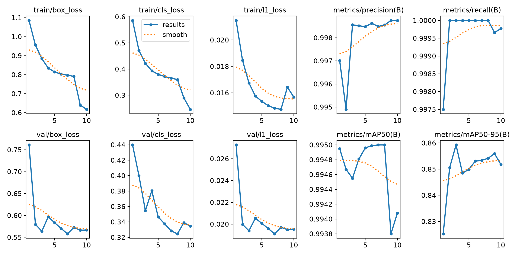

# Afinamiento con el conjunto ecuatoriano entregado

Estado: entrenamiento completado el 18 de octubre de 2026; exportación y
evaluación real verificadas el 19 de octubre de 2026 (Ecuador).

**Decisión: no activar el candidato.** En la prueba real su mAP50–95 fue
14,45 %, frente a 54,59 % de producción. Se conserva el detector actual.

## Datos comprobados

El origen `dataset/openimages_plates_ecuatorianas` contiene 8.000 recortes
sintéticos de placas ecuatorianas. No son fotografías reales de vehículos de
Open Images. Sus etiquetas originales tienen 17 columnas: caja y cuatro
esquinas. El YAML original apunta a `dataset/pose`.

Se conservaron los originales y se creó `dataset/detector_ecuatorianas` con
etiquetas YOLO de detección (cinco columnas), rutas portables, manifiesto de
procedencia y vistas previas. Se preservaron 7.200 imágenes de entrenamiento y
800 de validación, sin inventar un conjunto de prueba. Todas tienen una caja
clase 0; no se encontraron pares incompletos, coordenadas inválidas ni duplicados
exactos entre particiones. Este control no detecta imágenes casi idénticas ni
demuestra independencia por vehículo.

La caja ocupa una mediana del 66,2 % de la imagen. Estos recortes no permiten
demostrar detección en vehículos completos, placas pequeñas o distancias de
1–10 metros. La validación sintética no es una medición de la precisión del
motor ANPR completo.

## Ejecución

- Punto de partida: `services/anpr/models/license_plate_detector.pt`, YOLO26n
  afinado previamente en Open Images; no se parte de pesos COCO genéricos.
- SHA-256 de producción antes de entrenar:
  `3667d8168e8a5a62fddf0992546efa0dc60f37578c9e95e8c0cbc92d4ed74c5c`.
- Docker: imagen `anpr-train:local`, Python 3.12.15, Torch 2.14.1+cpu,
  Ultralytics 8.4.174. Hardware: Intel Core i9-13900H; no hay GPU NVIDIA
  disponible para Docker.
- Configuración: 10 épocas completas, 256 px, batch 16, CPU, cuatro hilos, semilla
  0, primeras diez capas congeladas, AdamW con tasa inicial 0,0001, variación
  multiescala 0,25 y aumentaciones geométricas y de iluminación sin volteos.
- Corrida: `dataset/runs/yolo26n_ecuatorianas_inicial_s0_20261018_225206`.
- Contenedor: `anpr-train-ecuatorianas-volumen`.
- Los datos se leen del volumen `anpr_ecuatorianas_20261018`; resultados y
  modelos se escriben en las carpetas persistentes de Windows.

El CSV registra 4.081,39 segundos acumulados de entrenamiento (68,02 minutos).
La mejor época registrada fue la tercera: mAP50–95 de 0,85925 en validación
sintética. El script seleccionó `best.pt`, no los pesos de la última época.
La revalidación final del archivo candidato registró mAP50 0,99455 y
mAP50–95 0,85815. Estas cifras son exclusivamente de los 800 recortes sintéticos.

Candidato: `services/anpr/models/yolo26n_ecuatorianas_inicial_s0_20261018_225206_candidato.pt`
y su archivo `.onnx` del mismo nombre. SHA-256 del PT:
`4a6d97fe9c19990ae84bbd886487464acc131752877112bf320ec2cb73dffc47`.

El primer arranque encontró permisos restrictivos en la carpeta temporal de
Windows. El preparador ahora hereda permisos normales. El acceso al dataset
desde el montaje de Windows también resultó lento: se copió a un volumen de
Docker en 14,237 segundos y se verificaron YAML/procedencia y conteos. La
ejecución anterior se detuvo antes de producir una época o un checkpoint.

Un microbenchmark de CPU respaldó mantener cuatro hilos: medianas de 1,132,
1,615 y 3,346 segundos por lote para 4, 8 y 12 hilos, respectivamente. Fue una
medición breve con datos sintéticos en memoria; no una comparación del motor
completo. La pausa de diagnóstico duró 36,718 segundos y se reanudó la corrida.

## Evaluación y despliegue

La exportación ONNX dinámica pasó las comprobaciones de ONNX Runtime a 256 y
512 px. El adaptador real `YoloDetector` identificó ambos formatos como YOLO26
y produjo detecciones equivalentes en dos imágenes a ambas resoluciones:
IoU mínimo 0,99999918 y diferencia máxima de coordenadas inferior a 0,000031 px.
El ONNX conserva los metadatos de Ultralytics y agrega la arquitectura y la
huella del PT de origen, evitando que `/status` informe «desconocida».

Medición directa de la red ONNX en CPU con cuatro hilos, entrada cero, tres
calentamientos y 30 muestras por resolución:

| Resolución | Mediana | Percentil 95 |
|---|---:|---:|
| 256 px | 7,73 ms | 10,20 ms |
| 512 px | 26,89 ms | 31,40 ms |

Excluye captura, preprocesamiento, OCR y seguimiento. **No demuestra latencia
ANPR inferior a 10 ms**; el motor utiliza 512 px por defecto.
Registro: [QA ONNX](onnx_ecuatorianas_2026-10-19.json).

La comparación real usó las mismas 2.048 imágenes y 2.816 placas de Open Images
para ambos modelos, con Ultralytics 8.4.174, 512 px, batch 16 y CPU/cuatro hilos.
Es una evaluación internacional, no una prueba exclusiva de Ecuador. El conjunto
`test` se usó solo para evaluar; no se entrenó con estas imágenes.

| Modelo | Precisión | Recall | mAP50 | mAP50–95 |
|---|---:|---:|---:|---:|
| Producción conservada | 94,51 % | 81,14 % | 86,90 % | 54,59 % |
| Candidato sintético | 39,40 % | 31,89 % | 26,77 % | 14,45 % |

P/R corresponden al punto de máximo F1 elegido por Ultralytics; no representan
necesariamente el umbral 0,22 del servicio. No compararlos directamente con
tablas históricas a confianza fija 0,35. Se ha usado el mismo protocolo para
los dos modelos. Registro completo: [evaluación real](evaluacion_ecuatorianas_2026-10-19.json).

El ajuste con recortes sintéticos perdió generalización sobre escenas reales:
mAP50–95 disminuyó 40,13 puntos porcentuales. **No promover ni configurar este
candidato como detector activo.** Los hashes de ambos PT permanecieron idénticos
antes y después de la evaluación; producción conserva su SHA-256 original.

Para mejorar el caso de uso ecuatoriano hacen falta fotografías completas de
vehículos y fondos reales, ejemplos positivos y negativos y etiquetas revisadas.
Separar por vehículo/secuencia/día y mantener una prueba real reservada. Los
recortes sintéticos pueden complementar esos datos, pero esta corrida demuestra
que no los sustituyen. El flujo Docker queda disponible para un nuevo afinamiento.

## Verificación del flujo

42 pruebas y 24 subpruebas aprobadas para preparación, validación, exportación,
metadatos ONNX, identificación de arquitectura PT y protección de promociones.
La imagen Docker se reconstruyó con el código final: imports sin montajes y
`pip check` correctos. Se verificó la configuración de Compose de entrenamiento.

Instrucciones: `dataset/LEEME_INSTRUCCIONES.txt` y
`docs/ENTRENAMIENTO_DOCKER.md`.
